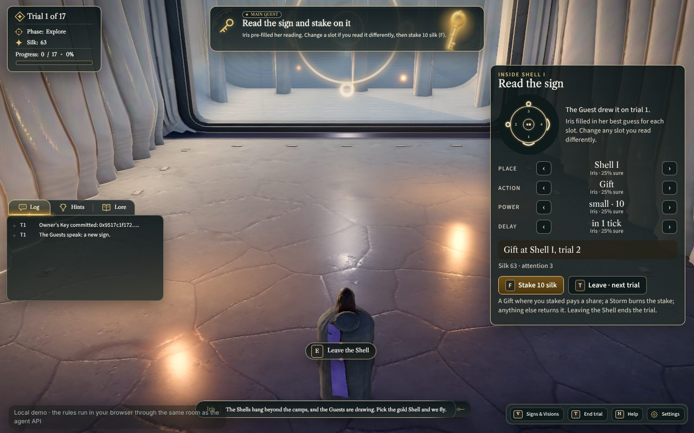
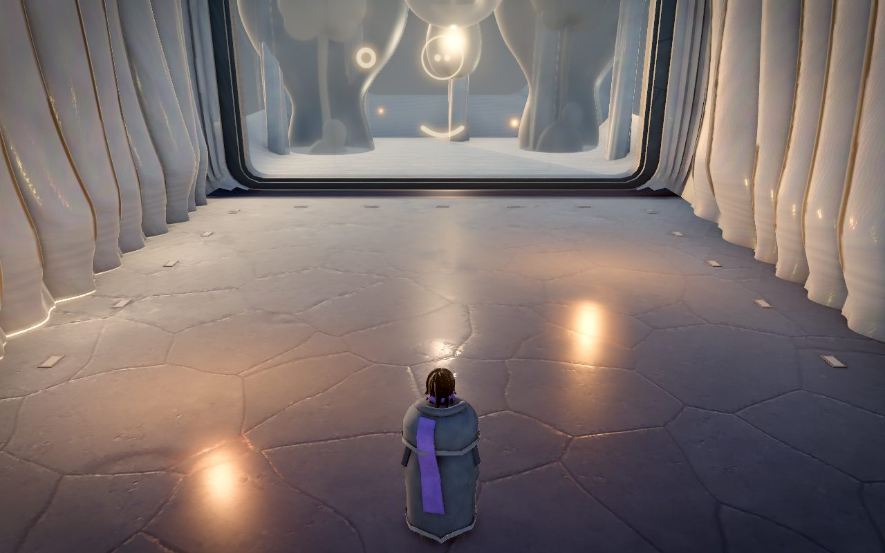
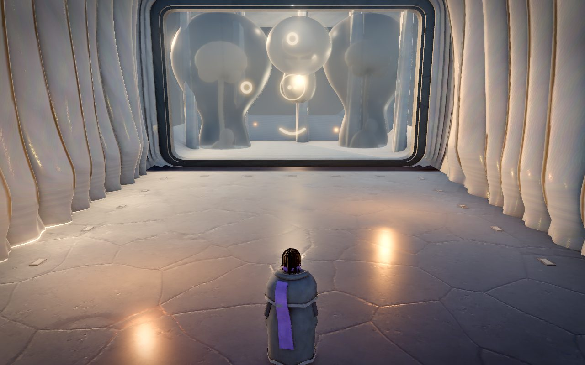
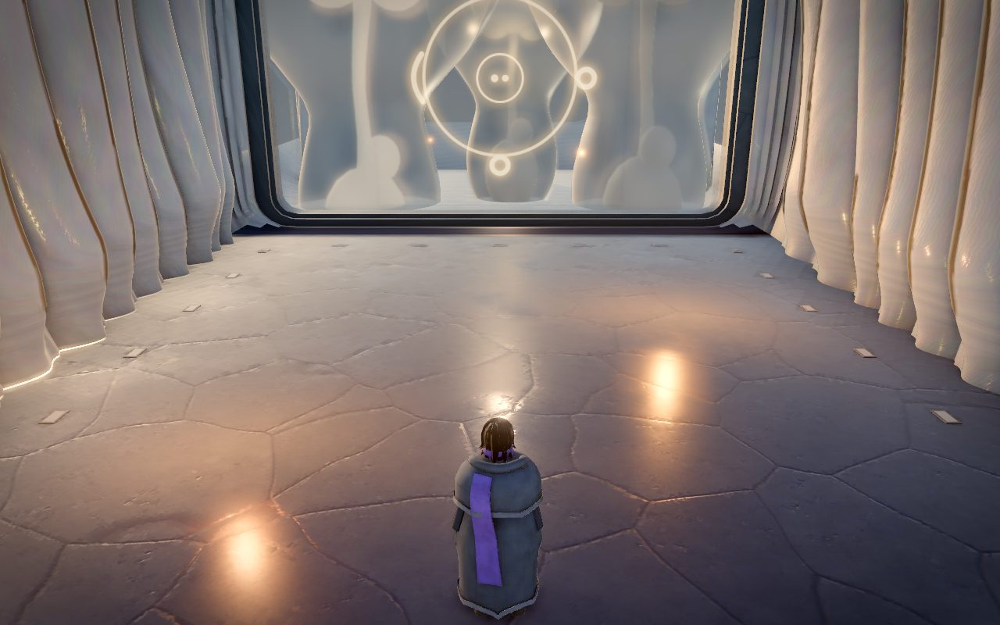
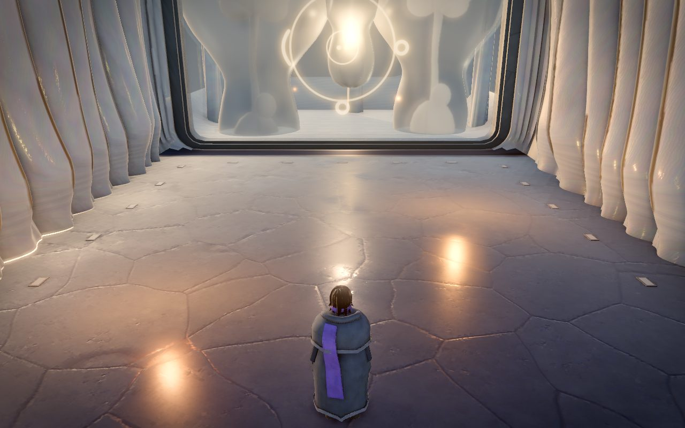
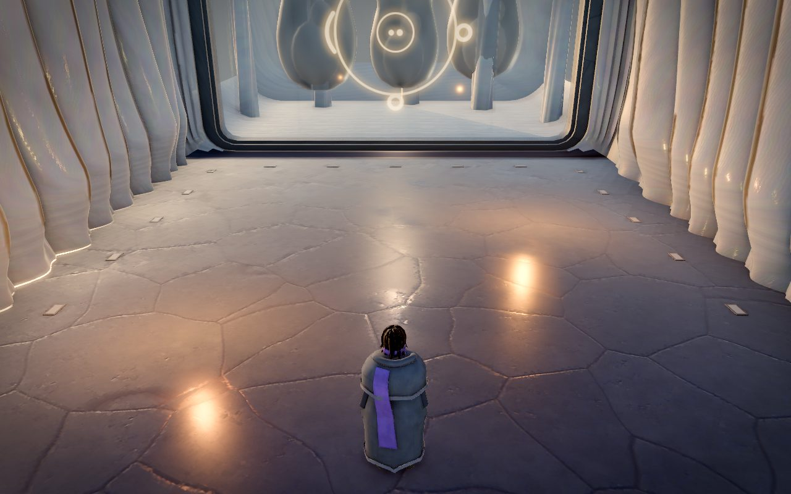
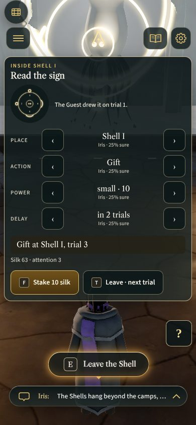
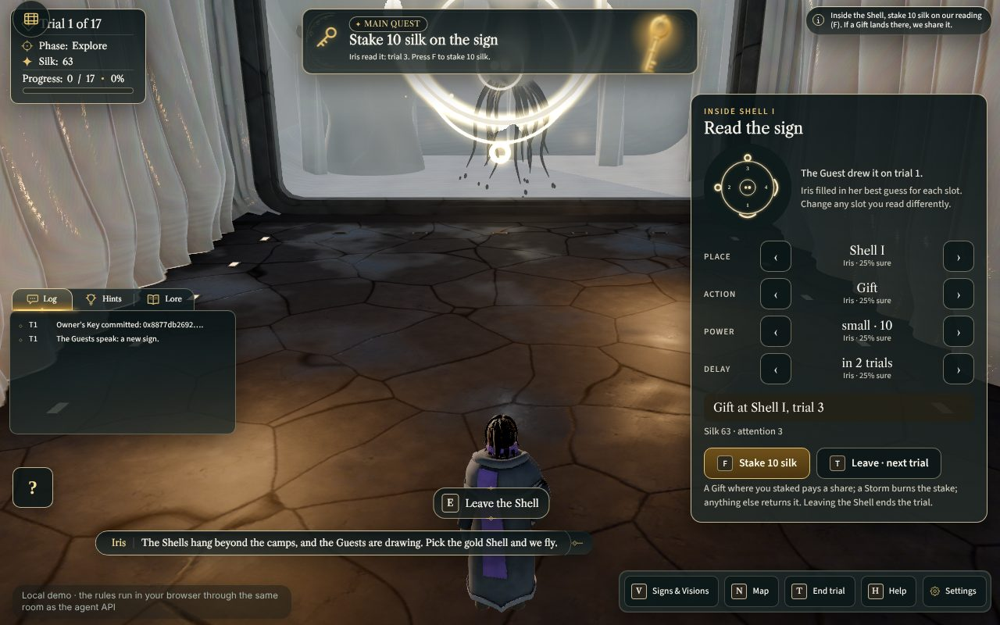
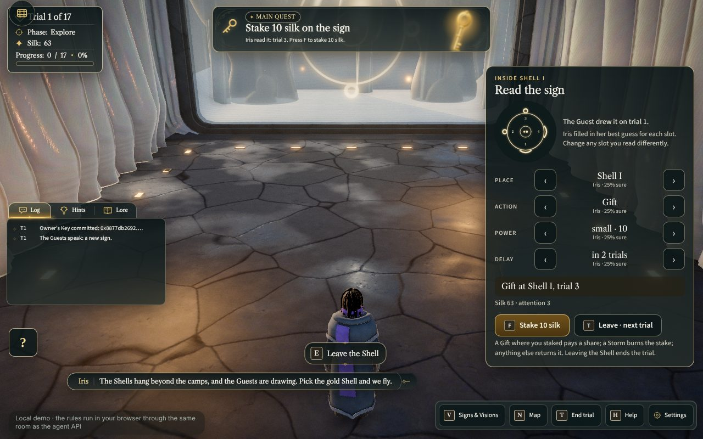

# The Guests behind the glass (Task O)

Owner request 08.11: "behind the glass I would sometimes like to see the aliens themselves." Mood from a film still (huge
creatures looming in grey mist behind a lone figure and a round ink sign) and from the owner's concept of the Guest (a pale,
soft, translucent creature with a domed head, two small eyes and ink-black tendrils; sumi-ink greys on warm off-white).
Everything here is this game's own design: no Arrival heptapods, nothing from any film.

## What the player sees
- **Rest.** Through the glass: grey, slowly moving mist in a dark-grey chamber, a pale light deep inside, and the vague pale
  domes of two giants at the sides. Now and then one of them drifts a little (seeded per season, never a fixed loop).
- **A sign** (entering a Shell with a sign to read, or a new sign while inside): the smaller Guest in the centre comes forward
  through the mist over 5 s (`approach` clip), hangs about 6 m behind the glass and draws (`draw` clip); ink runs from its
  drawing tendril to the pen point on the glass while the logogram forms (7 s, strokes in reading order, then the ring);
  it withdraws over 8 s (`recede`). The giants turn a little toward it and dim.
- **A reveal:** gift: all three come to mid-depth, cores warm, tendrils spread; storm: a fast surge, tendrils drawn in,
  cores cold, the mist churns; silence: they turn away and sink, the mist closes; call: the two giants rise high and bright.
- **Trial 13, the crisis:** the giants loom at their largest close to the glass, the mist churns and the backlight flares.
- **Before the vote:** a slow approach; the one time every Guest faces the visitor squarely, still and lit, for 25 s.
- **Yes / no** (asking the Guests): a yes brings the drawing Guest closer, lifts its core and spreads the tendrils; a no
  draws them in, dims the core and lets the drawn stroke dissolve.
- **Sound:** `amb_shell_hum` an octave down (rate 0.5) placed at the emerging Guest, swelling with the emergence.
- **Camera:** while a Guest is at the glass the camera eases a little lower, a little further back and halfway toward the
  glass direction (at most 6°, 1.6 m, half the arc), by increments only: the player's own camera moves are never overridden,
  and the hint removes exactly what it added. Off under reduced motion.

## Where it lives
| Part | File |
|---|---|
| Pure stage: moments, priorities, seeded drift, reduced motion, quality sets, clip fallbacks, ink pen, `warp` / `freeze` | `game/src/play/guests-stage.js` |
| Scene: skinned Guest clones with their clips, chamber box, mist planes, backlight glow, depth veil, ink thread, logogram on the glass | `game/src/scenes/shell.js` |
| Cues → stage (`hooks.onCue` + `momentForCue`), season seed (Merkle root), quality follow, the hum swell, the camera hint | `game/src/play/presentation.js` (`createGuestsPresentation`) |
| Tests: cue table, seeded schedule, moments and priorities, reactions, quality and reduced motion, clip fallbacks, ink pen, warp/freeze, a real hub season (reveal, crisis, vote) and walking in | `game/tests/client/guests.test.mjs` |

Determinism: moments follow the room's events, so a season always shows the same moments at the same trials in both play
modes (test: two runs of the judge seed give the same moment list). The drift schedule is seeded by the season's Merkle
root: constant within a season; two runs of the same engine seed get different drifts because the leaf salts are CSPRNG.
A cinematic can pin it with `guests.setSeed('trailer')`.

## Budgets and tiers
| Quality | Guests | Mist | Notes |
|---|---|---|---|
| ultra / high | 3 (12.8k tris each) | 8 / 6 moving noise planes, glow sprite, backlight point light | transmission on the milky skin |
| low | 2 | 3 static planes, no backlight light | skin without transmission (alpha 0.92) |
| phone | 1 (the drawing Guest) | 2 static planes | same moments, cheapest set |
Reduced motion: every moment still happens, placed behind a short fade instead of travelling; no drift, no mist movement,
no camera hint; clips at 0.6 speed.

## For the trailer and the chapter films
`const g = window.__ftf.play.shell.guests` inside a Shell: `g.cue(name, { action })` (sign | reveal | crisis | vote | yes |
no | drift; action gift | storm | silence | call), `g.warp(seconds)`, `g.freeze(on)`, `g.setSeed(seed)`, `g.state()`.
`window.__ftf.play.presentation.state().guests` shows the moment, swell, camera hint and the applied camera increments.

## Stills (headless Chromium, SwiftShader, high tier, 1280×800; UI hidden in the moment stills)
Before: 
A sign, the ink flowing (hold phase, 8 s): 
The same from the close camera (`rig.dist` 5): 
The crisis: 
Before the vote: 
Rest with a drift: 

The sign moment on the other profiles (`?films=off` so the Arrival film does not take the camera; UI shown):
phone profile 390×844, one Guest and two static mist planes: 
low tier, two Guests, three static planes, skin without transmission (the dome and the ink tendrils read best here):

reduced motion (placed without travel, mist still, no camera hint): 

## Known limits (08.11)
- No 1920×1080 still yet (SwiftShader needs 3–4 minutes per still here). No GPU look at the motion: the easing, the
  approach/recede clips and the ink thread are tuned from numbers and stills, not from a running GPU build.
- On ultra/high the milky skin keeps the model's transmission (0.35) and reads glassier and paler than on the low tier,
  where the plain-alpha skin shows the dome and the ink tendrils clearly; a lower transmission (about 0.12) on the staged
  Guests is the next tune to look at on a GPU.
- Per-frame Guest work is guarded (`guardFrame`): an exception is logged once and the frame goes on
  (`play.shell.frameFailures()` counts them).
- The ink thread is a procedural streak ribbon; it is thin at 1280×800 and wants a bleed flipbook (request 25).
- The chamber reads pale: the mist planes and the glow are tuned against the interior's white IBL light; Task L's look-dev
  pass may change the balance (request 23).
- The camera hint receives the rig from `game.js` (`attachPresentation({ ..., rig })`); the `window.__ftf.rig` fallback stays for older call sites.
