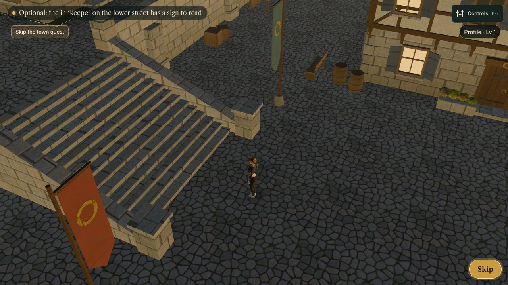
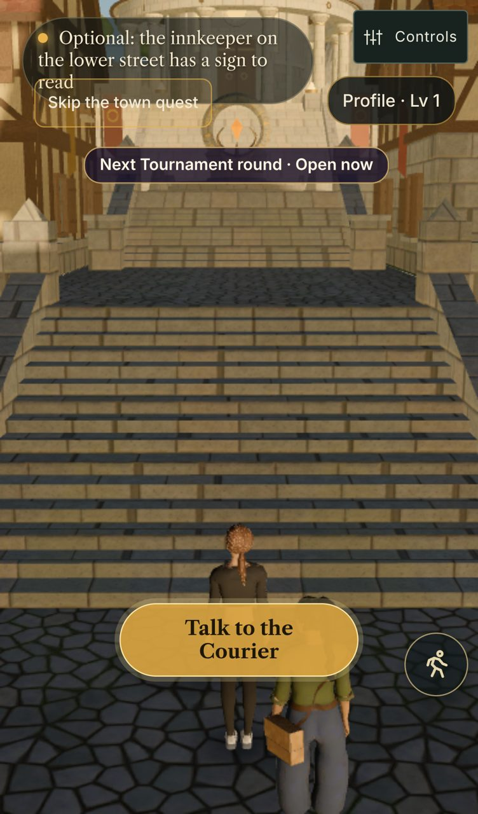
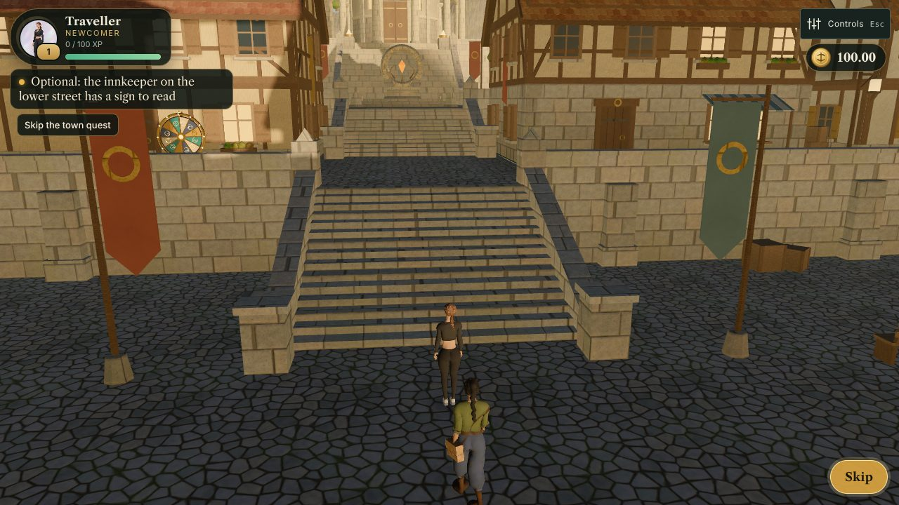
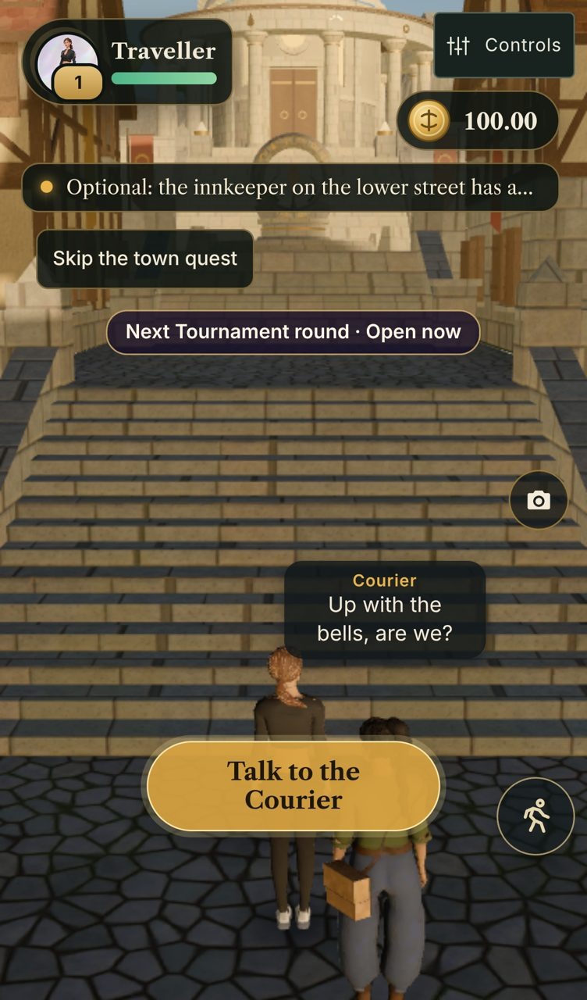

# Player HUD (town), 12.11

Before: live site before this change. After: `claude/jury-ready` built locally. Desktop 1280×720 and iPhone 13, `?day1=0`,
7 s after the town appears. The overlap probe (frame, wallet, objective, skip button, altar timer, E prompt) reports
no overlapping boxes and no horizontal scroll on either size.

| | Desktop | Phone |
|---|---|---|
| Before |  |  |
| After |  |  |

What changed (`game/src/scenes/player-hud.js`): portrait frame with level ring, title, XP and health with a damage trail;
the town objective as a quest tracker under it (tap to fold; one line on phones, tap to unfold); the silk wallet at the
top right with a coin (SVG placeholder until `assets/ui/icons/silk_coin.webp` lands), a count that ticks up, floating
+/- deltas and the sealed-chest badge; one toast stack under the wallet. Town only: the archipelago keeps its trial/silk
HUD (judge path unchanged). The bottom-left corner stays free for the chat panel.
