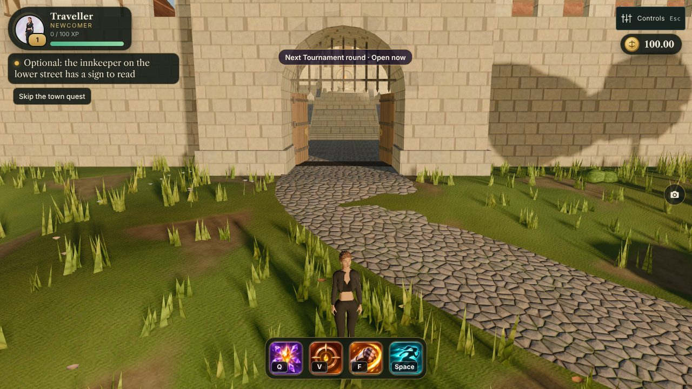
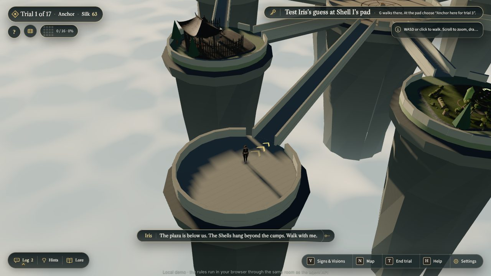
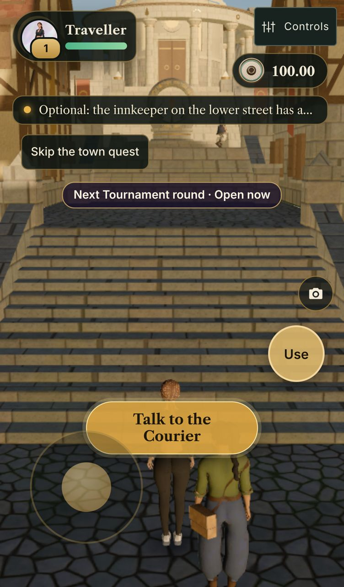
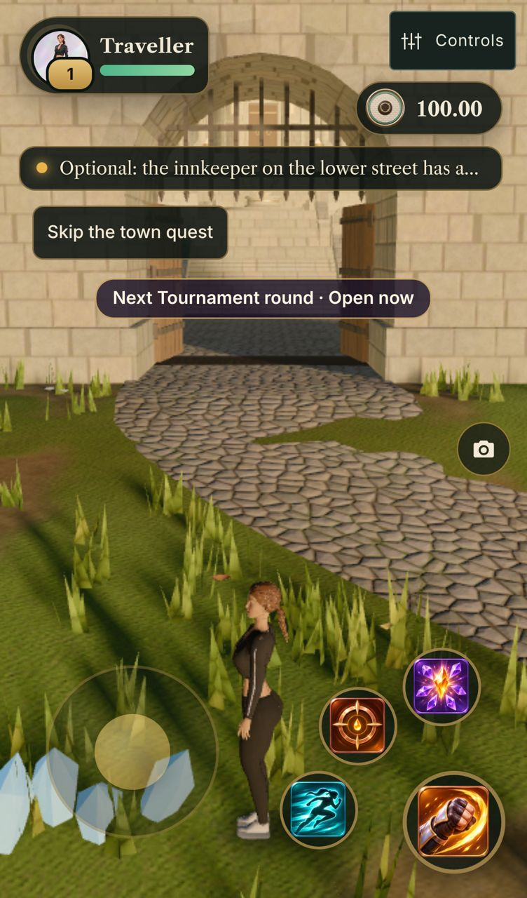
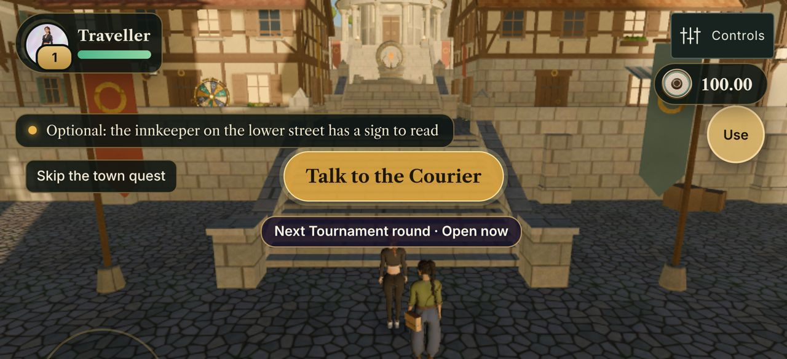
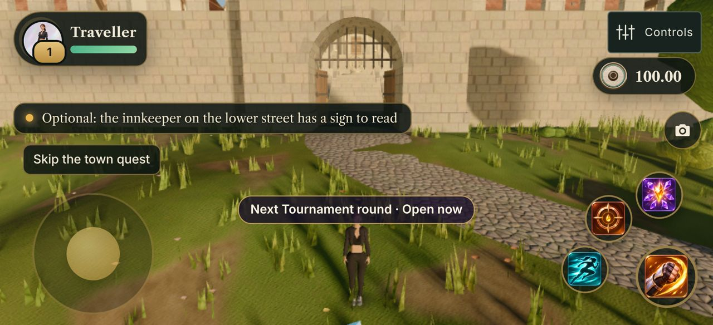

# Player HUD (town), 12.11

Before: live site before this change. After: `claude/jury-ready` built locally. Desktop 1280×720 and iPhone 13, `?day1=0`,
7 s after the town appears. The overlap probe (frame, wallet, objective, skip button, altar timer, E prompt) reports
no overlapping boxes and no horizontal scroll on either size.

| | Desktop | Phone |
|---|---|---|
| Before |  |  |
| After |  |  |

What changed (`game/src/scenes/player-hud.js`): portrait frame with level ring, title, XP and health with a damage trail;
the town objective as a quest tracker under it (tap to fold; one line on phones, tap to unfold); the silk wallet at the
top right with a coin (SVG placeholder until `assets/ui/icons/silk_coin.webp` lands), a count that ticks up, floating
+/- deltas and the sealed-chest badge; one toast stack under the wallet. Town only: the archipelago keeps its trial/silk
HUD (judge path unchanged). The bottom-left corner stays free for the chat panel.

Outside the lower gate (skill bar in the HUD palette, health in the frame) and on the archipelago (player HUD hidden;
the judge HUD shows "Trial 1 of 17 · Silk 63" as before):

 

## Touch: twin sticks and the skill arc (iPhone 13, portrait and landscape)

Left: a floating joystick (analog walk, run when pushed far); the rest of the screen drags the camera. Bottom right:
the attack button with Frost Lance, Storm Snare and Dash on an arc (cooldown sweeps; the casts aim by dragging, a tap
casts at the nearest monster in range); an action button appears above the arc when the town offers one. Checked in
the built game: the stick walked Iris out of the lower gate, the arc appeared, a tap on Frost Lance cast it, no errors.
The ⇄ button on the portrait switches Iris / Elise once Elise is unlocked. Controls → "Touch: use tap to move" switches
back to the old scheme (stored). Desktop is unchanged; the archipelago (judge path) keeps tap-to-move and its buttons.

| Portrait | Landscape |
|---|---|
|   |   |
