# UI polish: the play layer after the owner's "this looks cheap" feedback (08.11.2026)

Branch `claude/ui-polish` (worker task F in `docs/handoff/worker-tasks.md`). The owner's words, with
screenshots of the live desktop build: "too little padding on the buttons, things stack on top of each
other". This document is the audit (what the screenshots showed, reproduced in headless Chromium), the
rules that fix it, the before/after screenshots and how to re-check. The world HUD mockups
(`docs/ui-world-hud.md`) stay the visual reference: only spacing, stacking and legibility changed, no redesign.

## 1. What the owner's screenshots showed (reproduced)

Headless Chromium (SwiftShader) on `/?demo=judge&play=direct`: open Signs & Visions with <kbd>V</kbd>, then
Memories with <kbd>M</kbd>. Desktop 1280×800, before:

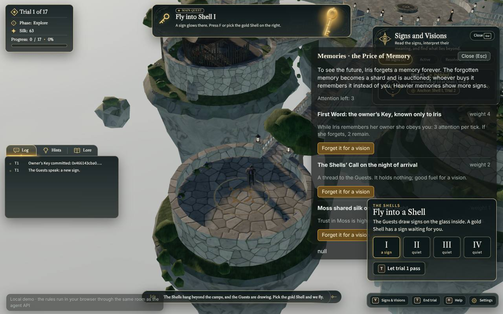

| # | Defect | Cause in the code |
|---|---|---|
| 1 | Memories opened on top of Signs & Visions; both stayed visible and the sign cards' text read through the memory cards | the play panels (`play/ui.js`), the HUD Signs panel (`ui/world-hud/signs.js`) and the help knew nothing of each other; `.pl-panel` used the greybox surface `rgba(20,24,22,.72)` |
| 2 | The Shell dock ("Fly into a Shell", I–IV, "Let trial 5 pass") overlapped the open panel | the hub layer (`play/hub-ui.js`, `z-index: 3`) rendered the dock regardless of the panels |
| 3 | Cramped buttons and tiny type: "Forget it for a vision" 30 px tall at 13 px, hotbar buttons 25 px tall with 9.5 px labels at 1280 wide, the gold "MAIN QUEST" pill 12 px tall with 7 px text touching its border | the greybox `.pl-btn` scale (6/10 px padding) and the HUD's purely proportional scale (`--wh-px` = 0.707 at 1280) with no floor |
| 4 | The nameplate ("Frost · fragment giver") floated in the scene as a translucent canvas sprite with a large faint circle, behind scenery edges and over a wooden board | `MindSprite` in `play/agents.js`: a 256×128 canvas on a `THREE.Sprite` with `depthTest: false`, scaled by camera distance |
| 5 | A stray "null" line at the bottom of the Memories panel | `panelShell(...)` appended a `null` child when Iris had forgotten nothing yet |

Phone 390×844 showed the same stacking (the Memories panel over the mobile quest and trial cards, the run toggle over
the panel), and the Signs sheet had no exclusivity with the panels either.

## 2. Rules now in force

### 2.1 One surface at a time (`game/src/play/panels.js`)

One arbiter per overlay root, shared by the play UI, the world HUD and the hub UI (they are created separately but
mount on the same `#ui`). Surfaces: `panel` (Memories, sign details, ask, dialogue, info, season end), `help`,
`signs` (the HUD panel / phone sheet) and `hub-card` (offer, fragment, Key, vote, Heir). `claim(id, close, {modal})`
closes whatever else is open; `release(id)` is a no-op once another claim replaced it, so the close callbacks can
be naive.

| Surface | Modal | Effect while open |
|---|---|---|
| play panel, help, hub card | yes | `body.pl-modal-open`: the Shell dock and the reading card are not rendered; on phones the run toggle hides and the panel carries a scrim |
| Signs & Visions (desktop) | **no** | the dock stays (read the signs, then pick a Shell); `body.hub-dock-on` caps the panel at `100% − 94u − 330px`, so it never reaches the dock's corner; the list scrolls |
| Signs & Visions (phone sheet) | yes | the sheet's own scrim covers the dock at the top |

A decision card claims the arbiter when it appears (it closes an open panel: the player must decide) and never
closes itself from a competing claim; after the player answers it, it releases. The play panels return focus and
the Signs panel keeps its opener logic unchanged (`signs.js` was not touched for this).

Stacking inside `#ui` (`z-index` 10, `pointer-events: none` in the world): nameplates 0 · world HUD 0 · play panels /
context menu / help 2 (4 on phones, above the dock) · hub dock, reading card, cards 3 · hub fade 6.

### 2.2 Spacing and type scale

Spacing 4 / 8 / 12 / 16 / 24 px; radii 10 px (buttons), 14 px (panels), 16 px (cards), 999 (pills); click targets
40 px on desktop and 48 px on phones; states: hover (gold hairline, lighter fill), pressed (1 px down),
focus-visible (2 px pale gold outline, 2 px offset), disabled (.45 opacity).

| Control | Before (1280 wide) | After |
|---|---|---|
| `.pl-btn` (Forget it for a vision, Close, picks) | ≈30 px, 13 px system-ui, 6/10 px padding | 40 px (48 on phones), 14 px Source Sans 3, 0/16 px padding, 10 px radius |
| context menu rows `.pl-opt` | ≈22 px rows | 40 px rows, 10 px gap, key caps 22 px |
| hub buttons (Stake, Leave, Let trial pass, cards) | ≈34 px, 13.5 px | 40 px (48 on phones), 14 px, 0/16 px |
| hub slot arrows ‹ › | 28 px wide | 40 × 40 px (44 on phones) |
| hotbar buttons | 35 u = 25 px, label 9.5 px | min 40 px, label ≥ 11.5 px |
| Signs panel Close | 29 u = 20.5 px, 9.9 px text | min 40 px, ≥ 12 px text, stadium |
| Signs filter chips | 34 u = 24 px | min 40 px (44 in the phone sheet) |
| dialogue reply, prompt | 48 u / 58 u | min 40 px |
| MAIN QUEST tag | 17 u = 12 px tall, 7 px text, 5/8 u padding | ≥ 20 px tall, ≥ 10 px text, ≥ 7/9 px padding |
| phone top-bar buttons, sheet close | 48 × 35, 35 px round | 48 × 44, 44 px round |

**Type floors in the world HUD** (`tokens.css`): every `--wh-fs-*` role is `max(N u, floor)`: body and stats 12 px,
ui labels 11.5, tabs 11, small 10.5, tag 10, key caps 10, rows/anchor/speaker 12, sign title 12.5, card title 15,
quest title 17, panel title 18. At the 1811 reference the floors are inactive and the mockup numbers apply; at
1280 they lift the smallest roles from 7–10 px to 10–12 px. This overrides the 08.11 "proportions over a floor"
choice below ~1600 px (recorded in `docs/decisions.md`).

**Surfaces.** Modal play panels use the HUD panel gradient (α .93–.95) on a solid base `#121d1f`, a hairline frame
`rgba(232,214,172,.62)` and the HUD shadow: nothing reads through, and no backdrop blur is needed (the blur was off on
the low tier anyway, which is why phones showed the HUD cards through the panel). Titles are Libre Caslon Text with
the HUD's weight stroke, body copy Source Sans 3; the gold text, muted and frame tokens are the HUD's.

### 2.3 Nameplates (`game/src/play/nameplate.js`, DOM in `play/agents.js`)

A screen-space DOM pill per agent in a fixed `.pl-plates` layer (first child of `#ui`, so every HUD panel draws over
it): a 7 px mood dot, the name in the serif face (13 px) and one short sans line (the mind glyph label or
"trust 50"). Each frame the head point (feet + 2.05 m) is projected through the camera; the plate's bottom-centre sits
10 px above it, so it never covers the face. Opacity 1 up to 30 m from the camera, fading to 0 at 60 m, scale 1 → .8
over the same band; the plate is dropped (not clamped) when the head is behind the camera or less than 64 px from a
viewport edge, and hidden inside a Shell. Being DOM it cannot clip into geometry; it can show over scenery that
stands between the camera and the agent (no occlusion test, see §5).

`game.js` passes `camera` and `uiRoot` into `agents.update(...)` (one argument added; without them no plate is drawn).

### 2.4 Reserved regions and the overlap check

Owner (via the lead, 08.11): "such details must be removed", about a prompt pill drawn over the tail of another
element. The rule is general: **no HUD element may overlap or partly cover another at any viewport in any locale.**
Every surface has a region; the regions below do not intersect at 1280×800, 1920×1080 or 390×844 (u = `--wh-px`, the
HUD unit: 0.707 px at 1280, 1.06 px at 1920; the play layer reads the same unit as `--pl-u`).

| Region | Desktop box | Notes |
|---|---|---|
| trial card | left 18 u, top 15 u, 246 u wide | |
| quest banner | centred, top 16 u, 717 u × 118 u | ends at 134 u |
| hint toast | right 14 u, top 12 u, 339 u × 51 u | |
| inspect hint `#prompt` | centred, top 152 u | greybox "I inspect … up close" |
| transient row: hub status, info flash, greybox toast | centred, top 152 u + 48 px | mutually exclusive by mode; stacked under the inspect hint |
| Signs & Visions | right 11 u, top 94 u, 460 u wide, max-height 100 % − 201 u; with the dock: 100 % − 94 u − 330 px | not modal on desktop |
| play panels, help | right 16 px, top 120 px, 460 / 400 px wide, max-height 100 vh − 220 px | one at a time; help moved from the left column, where it covered the trial card and the log tabs |
| hub reading card | right 16 px, top 120 px, 380 px | hidden under modals |
| log tabs + body | left 18 u, top 522 u, 409 u × 264 u | |
| HUD prompt | centred − 23 u, top 618 u | |
| context menu | centred, bottom 23 u + 60 px + 12 px + 46 u + 12 px | above the dialogue row |
| dialogue strip | centred − 45 u, bottom 38 u; lifted to 23 u + 60 px + 12 px when it would meet the hotbar; max-width 100 vw − 736 px + 90 u, long lines wrap | the mockup width whenever it fits |
| hub dock | right 16 px, bottom 23 u + 60 px + 12 px, 340 px | 12 px above the hotbar whatever its height |
| hotbar | right 15 u, bottom 23 u, min-height 53 u (buttons ≥ 40 px) | |
| demo badge | left 16 px, bottom 8 px, max-width min(340 px, 26 vw) | clear of the dialogue strip |
| nameplates | world-anchored; proximity only (≤ 7 m); hidden when their box meets any of the above | |
| phones | top bar 14 px; bottom-anchored stack quest card → trial card → tiles → prompt → dialogue bar; the sheet from 114 px; modal panels from the bottom with a scrim; the mobile HUD stack is hidden under any modal | |

`npm run hud:overlap` (`game/scripts/hud-overlap.mjs`, headless Chromium with the pre-installed Playwright) walks the
states island · Signs · Memories · help · Shell reading · Shell + Memories · decision card (synthetic) · walk · Scroll ·
agent · walk + Memories at the three viewports in the five locales, measures every visible HUD box (the leaf components
above, ancestors excluded) and fails on any intersecting pair; it also collects console errors and warnings. Edits to
`game/` while it runs make Vite reload the page and invalidate the run.

## 3. Before / after

Desktop 1280×800:

| State | Before | After |
|---|---|---|
| island, hub dock | 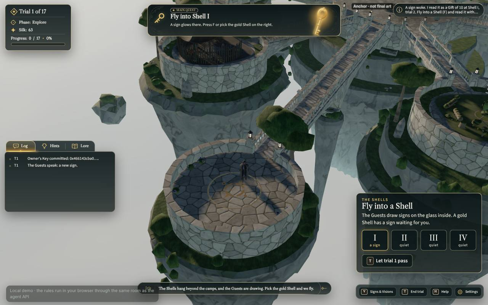 | 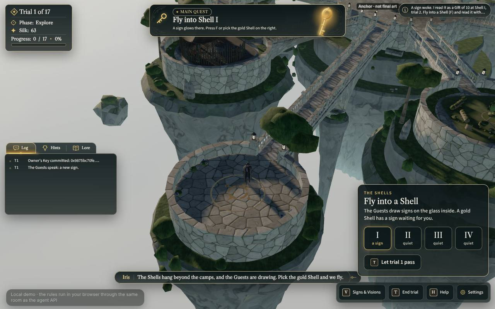 |
| <kbd>V</kbd> Signs & Visions | 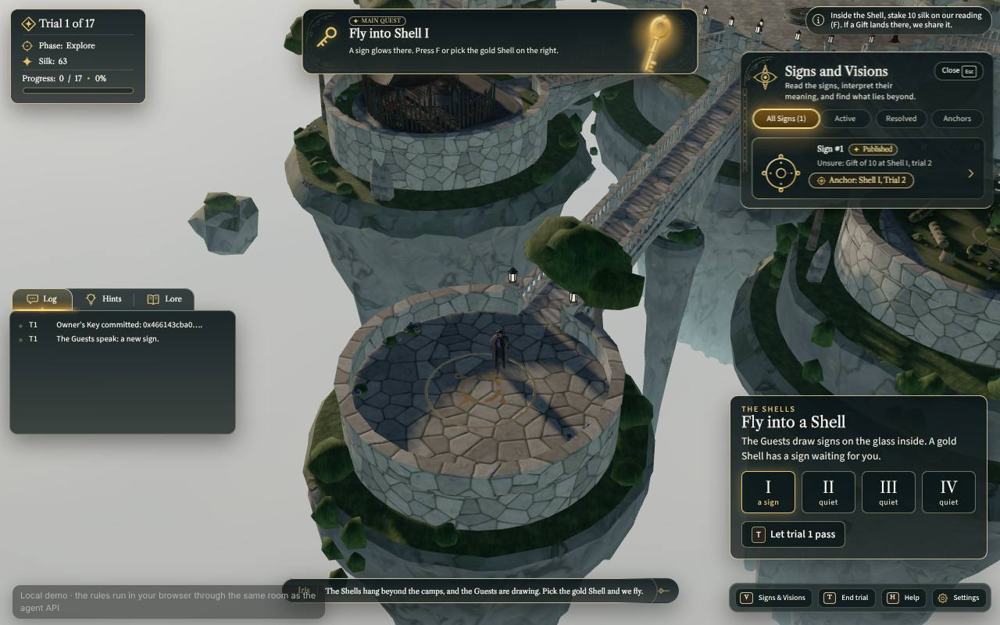 | 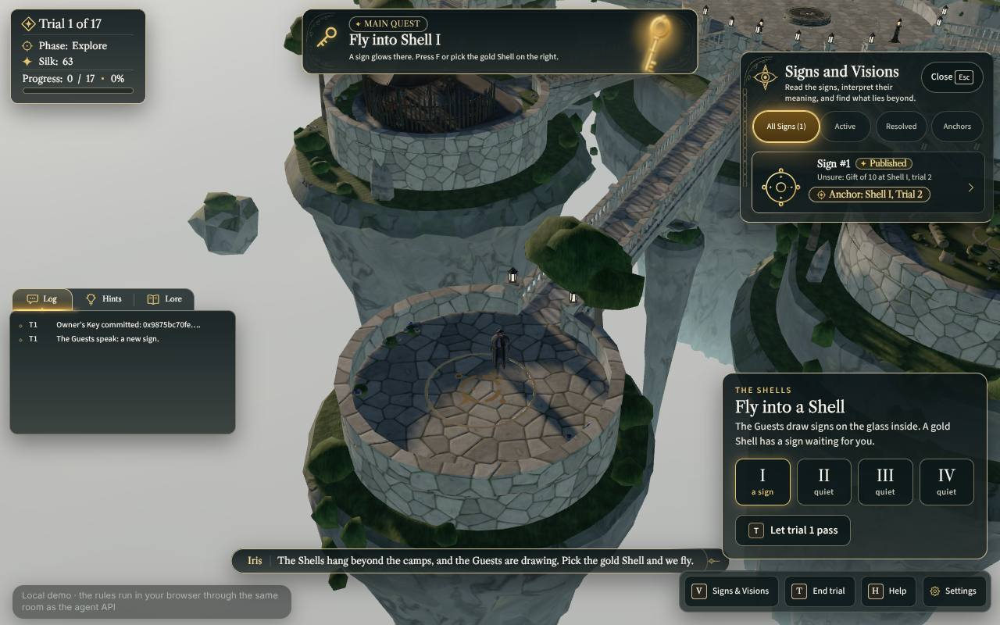 |
| <kbd>M</kbd> Memories (after V) |  | 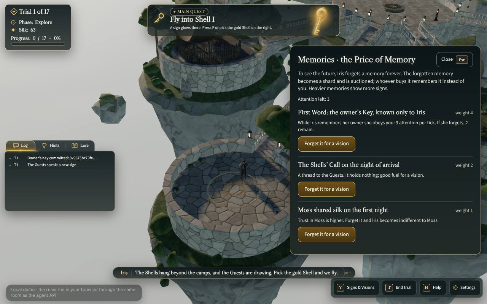 |
| nameplate (`?mode=walk`, in front of Frost) | 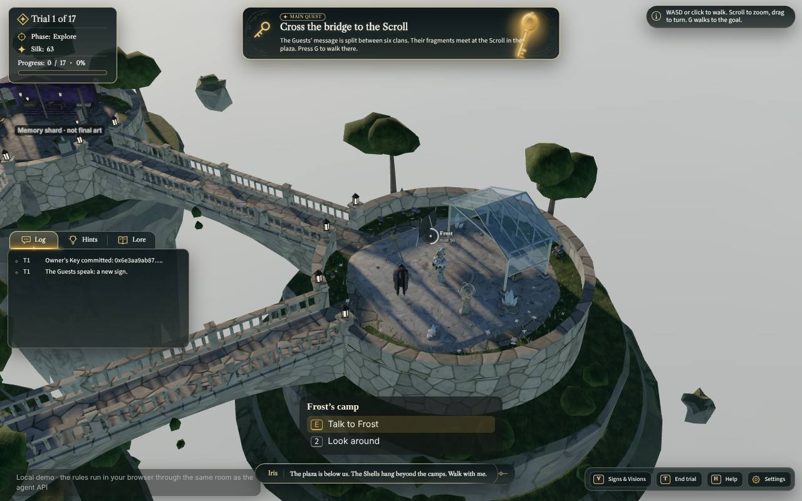 | 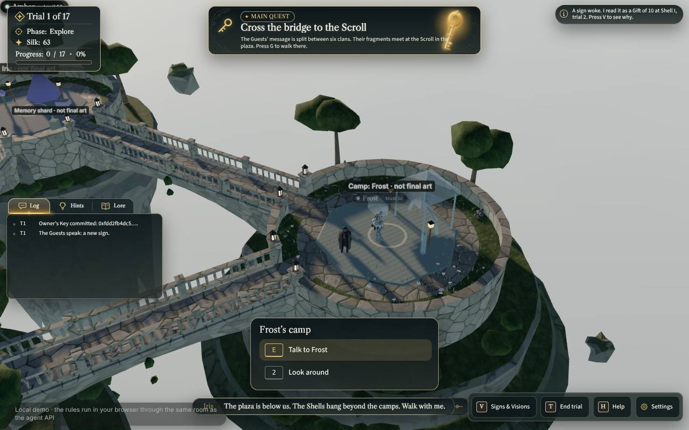 |

Phone 390×844 (iPhone-class emulation):

| State | Before | After |
|---|---|---|
| island | 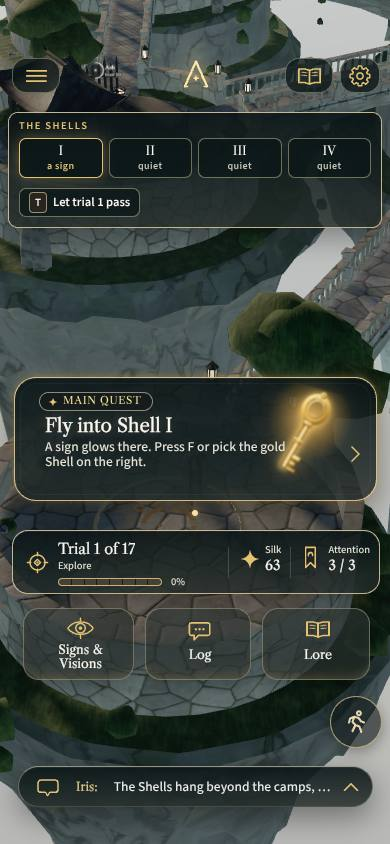 | 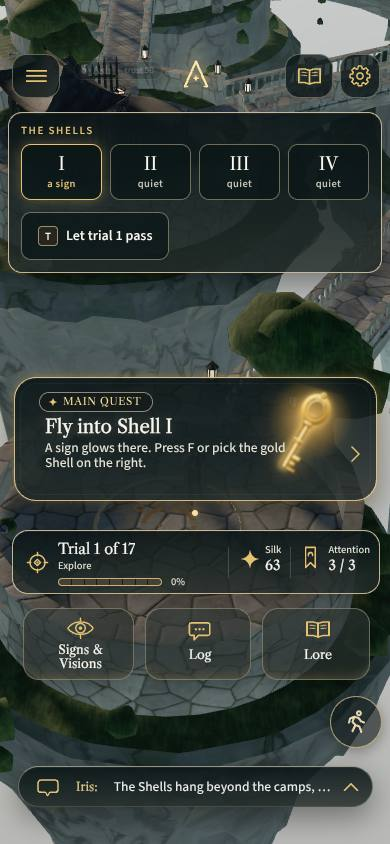 |
| Signs sheet |  | 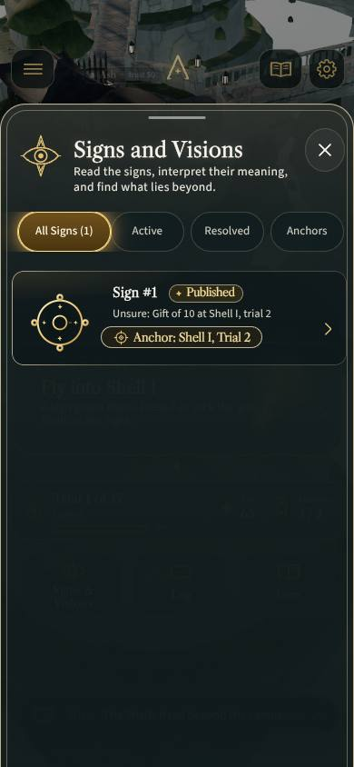 |
| Memories | 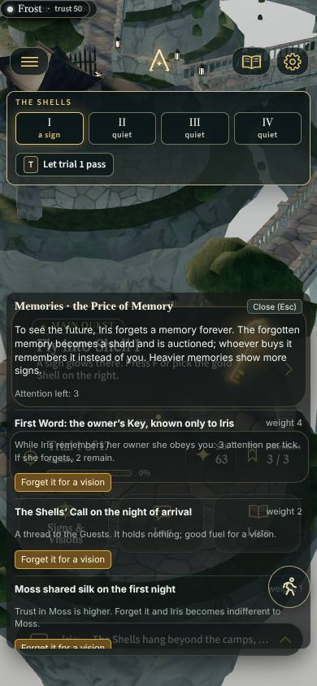 | 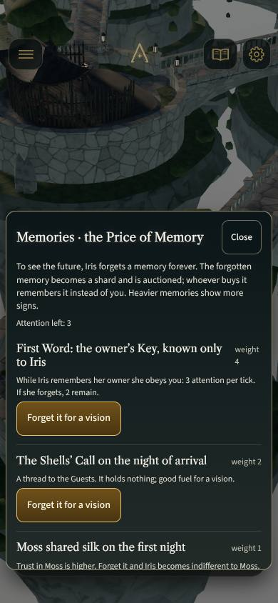 |

Desktop 1920×1080 after: 

Locales at 1280 (longest strings): Ukrainian  · Italian
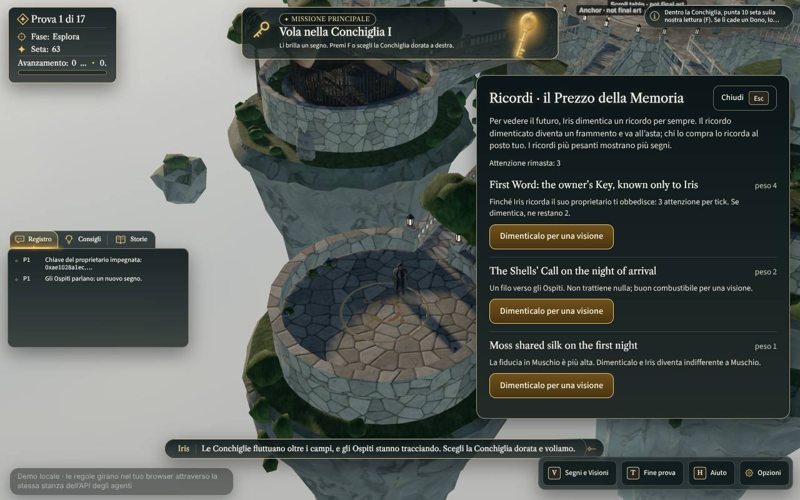

Measured element boxes from the same runs (`getBoundingClientRect`, CSS px):

| Viewport | State | Signs panel | Memories panel | Hub dock |
|---|---|---|---|---|
| 1280×800 before | V then M | 947,66 325×200 (visible) | 792,120 472×541 (visible) | 934,506 330×210 (visible, under the panel) |
| 1280×800 after | V then M | closed | 762,120 502×550 | not rendered |
| 390×844 before | V then M | sheet open under the panel | 8,360 374×438 | 8,112 374×116 (visible) |
| 390×844 after | V then M | closed | 8,295 374×503 (scrim behind) | not rendered |

Console errors in every run: 0.

## 4. How to re-check

```bash
cd game && npm run dev -- --host 127.0.0.1 --port 5173
# node with the pre-installed Playwright; SwiftShader renders at a few FPS, so the script drives the UI
# through window.__ftf.play.handleKey(...) instead of page.click and reloads when the tab dies at 1920 wide
node /path/to/shoot.mjs out after en 1280x800,390x844,1920x1080
```

The script used here is reproduced in `docs/handoff/agent-reports/ui-polish.md`; the pure rules are covered by
`game/tests/ui-polish.test.mjs` (exclusivity, modality, nameplate placement, the stylesheet rules above).

## 5. Not done / open

- **Occlusion for nameplates:** a plate can show over a wall that hides the agent (DOM has no depth). A per-agent
  raycast every few frames would fix it; left out to keep the frame cheap on phones.
- **Greybox labels** ("Camp: Frost · not final art", "Memory shard · not final art") still float in the scene in
  `?mode=walk`: they come from `game/src/render/greybox.js` (not in this task's paths) and read exactly like the debug
  label the owner disliked; the lead should decide whether they ship.
- **Signs panel transition in screenshots:** the panel slides in over 160 ms; at a few FPS a screenshot taken 1.5 s after
  <kbd>V</kbd> can still catch it half-faded (the after-1280-signs shot). Not a bug in the UI.
- **Pro mode default:** the Signs panel starts open in Pro; it now closes when a modal panel opens and stays closed
  until <kbd>V</kbd>.
- **Hub boxes keep the HUD's translucent panel gradient** (α .84–.90 plus blur) because they sit over the scene only;
  the decision cards are solid (α .96).
